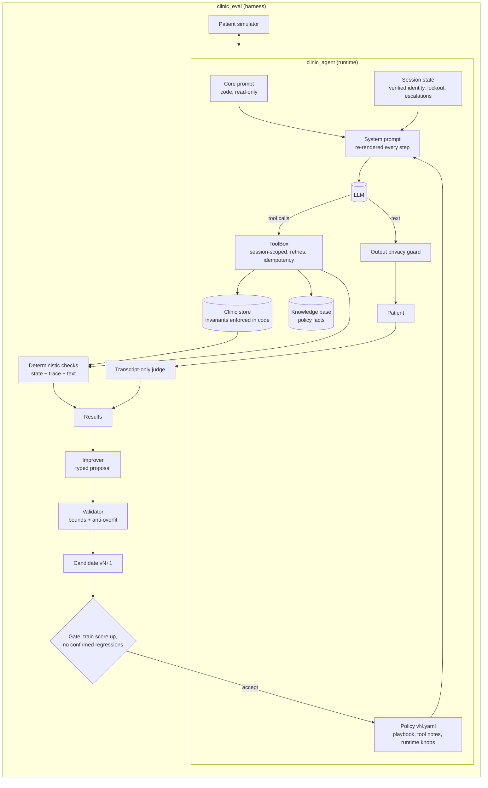

# Architecture

## Components

## Trust boundaries

| Concern | Enforced by | Editable by the loop? |
|---|---|---|
| Identity (name + DOB, 3-attempt lockout, no enumeration oracle) | `tools.py` | No |
| Cross-patient access | Session binding: tools never take a patient id | No |
| Double booking, overlaps, age rules, atomic reschedule | `clinic/db.py` | No |
| Retry safety for writes | Idempotency keys per session/patient/slot | No |
| Leaking other patients' names/DOBs | Deterministic output guard in `agent.py` | No |
| Conversation behaviour (read-backs, phrasing, when to look things up) | Prompt + playbook | Yes (playbook, tool notes) |
| Timeouts, retry counts, result sizes | `policy.runtime` | Yes, within `RUNTIME_BOUNDS` |

The principle: anything that can be checked in code is checked in code. The model is trusted only with
things that need language (what to ask, how to phrase, when to escalate), and that is exactly the surface
the improvement loop may change.

## Security notes

- Prompt injection cannot widen access: even a fully hijacked model can only call tools scoped to the
  session's verified patient.
- `NOT_VERIFIED` is identical for "unknown name" and "wrong DOB", and `NOT_FOUND` is identical for
  "no such appointment" and "someone else's appointment".
- The improver cannot touch security limits; `MAX_VERIFY_ATTEMPTS` is a code constant, and an attempt to
  set it is rejected by `AgentPolicy.apply` (covered by a unit test).
- Secrets live only in `.env` (gitignored). The LLM response cache in `.cache/` is gitignored too, since it
  contains synthetic but realistic patient conversations.

## Production gaps (not built here)

Real EHR/PM integration (FHIR `Slot`/`Appointment`), audit log persistence, PHI-compliant LLM hosting with
a BAA, stronger identity verification (OTP to phone on file), human review queue for escalations,
and observability on live conversations feeding back into the scenario set.
